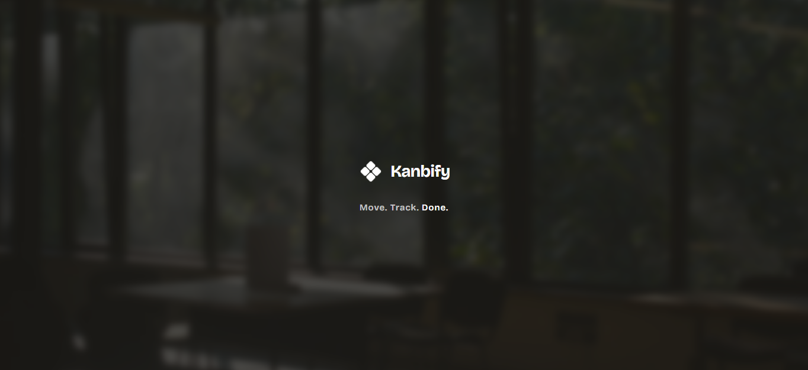
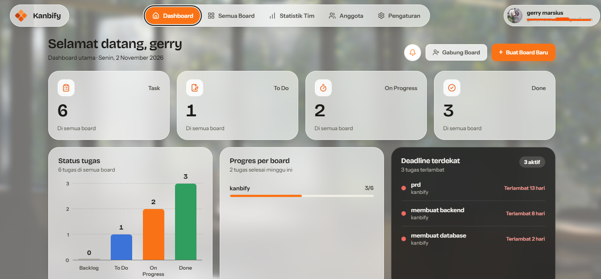
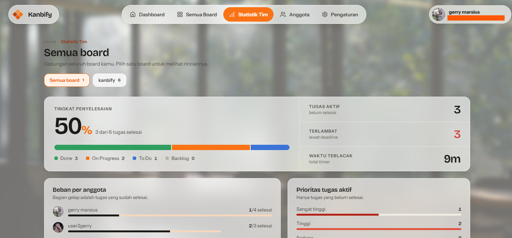

# Kanbify

Aplikasi manajemen tugas berbasis papan Kanban untuk tim kecil. Anggota
board bisa membagi tugas, melacak waktu pengerjaan, melihat jadwal di
Gantt Chart, dan menerima notifikasi aktivitas.

## Preview Aplikasi

### Splash Screen

### Dashboard

### Statistik Tim

## Fitur

-   **Autentikasi**: daftar, masuk, keluar, dan ubah profil (termasuk
    foto).
-   **Board**: buat board, bintangi board favorit, ubah latar belakang,
    hapus board.
-   **Undang anggota**: bagikan kode undangan, anggota lain bergabung
    lewat kode. Peran admin dan member; admin ditandai mahkota di
    samping judul board.
-   **Kanban**: kolom To Do, In Progress, Done, plus Backlog. Tugas bisa
    di-drag antar kolom.
-   **Kartu tugas**: prioritas, penanggung jawab, rentang tanggal, chip
    sisa waktu, dan timer play/pause di kartu In Progress.
-   **Gantt Chart**: jadwal tugas dari tanggal mulai sampai deadline,
    dengan zoom Minggu/Bulan dan garis hari ini.
-   **Files**: unggah dan unduh file per board.
-   **Statistik tim**: statistik per board (distribusi status, beban per
    anggota, prioritas dan keterlambatan, waktu terlacak).
-   **Kalender**: kalender tenggat semua board ada di bawah panel
    statistik Dashboard.
-   **Notifikasi**: lonceng di dashboard berisi aktivitas anggota
    (status berubah, tugas diedit atau dihapus). Ringkasannya juga
    dikirim ke email anggota tiap 10 menit.

## Teknologi

  -----------------------------------------------------------------------
  Bagian                              Isi
  ----------------------------------- -----------------------------------
  Frontend                            React 18, Vite, Tailwind CSS,
                                      lucide-react, animejs,
                                      react-router-dom

  Backend                             Laravel 13, Laravel Sanctum

  Database                            MySQL
